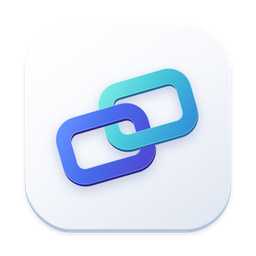
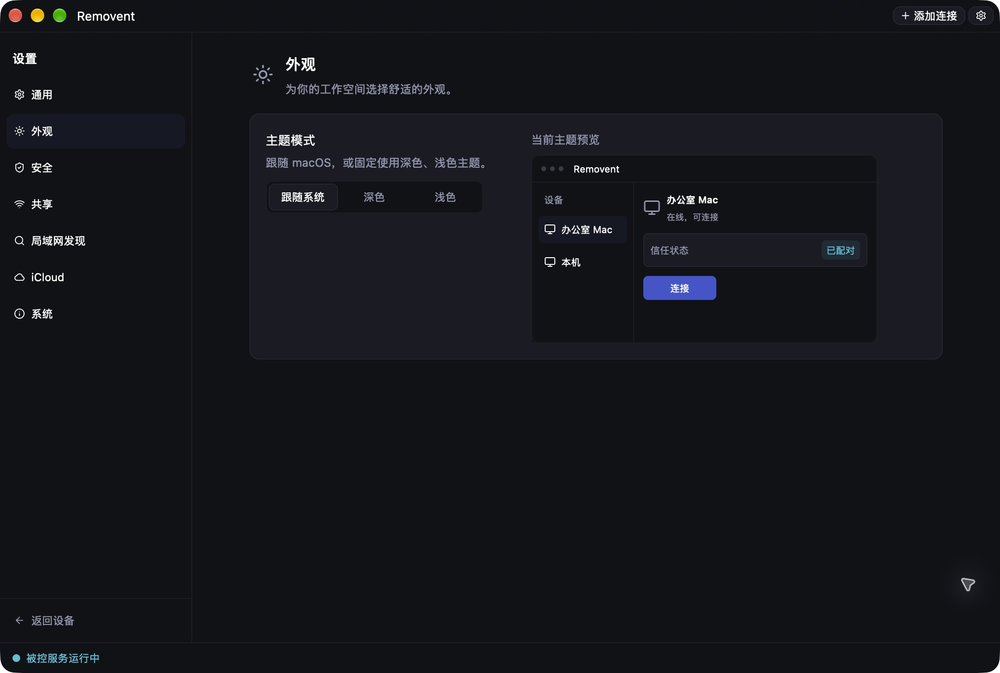

<p align="center">
  
</p>

<h1 align="center">Removent</h1>

<p align="center">
  Remote desktop for your Macs, with iPhone and iPad controllers.<br>
  Connect on your LAN or through a relay you run yourself. No hosted account required.
</p>

<p align="center">
  <a href="https://github.com/backrunner/removent/releases"></a>
  
  
  <a href="LICENSE"></a>
</p>

<p align="center">
  <a href="https://removent.pwp.sh">Website</a> |
  <a href="https://github.com/backrunner/removent/releases">Download</a> |
  <a href="docs/guides/cli.md">CLI guide</a> |
  <a href="README.zh-CN.md">简体中文</a>
</p>

<p align="center">
  
  <br><sub>The macOS app, shown in Simplified Chinese. English is also available.</sub>
</p>

## What you can do

| | |
| --- | --- |
| **Control a Mac** | Native RVP sessions with keyboard, mouse, clipboard and audio, using QUIC and hardware HEVC/H.264 video. |
| **Use your phone or tablet** | The [SwiftUI controller](apps/mobile/README.md) shares the desktop's Rust connection engine. Requires iOS/iPadOS 26+. |
| **Reach existing servers** | Connect to VNC, Apple Remote Desktop and RDP servers from the same app. |
| **Keep a host available** | A separate background service and menu bar app support hosting after the main window closes. |
| **Connect across networks** | Run a private Rust relay on a VPS, or deploy it to Cloudflare Containers. |
| **Manage from a terminal** | Query status, change settings, manage pairing and configure launch at login through the bundled CLI. |

Bonjour discovery can be enabled separately for Removent, VNC and RDP. It uses
service advertisements without scanning subnets or ports. Add unadvertised hosts
manually by address.

## Install

**Mac app:** macOS 26 or later on Apple Silicon.

Download the DMG from [GitHub Releases](https://github.com/backrunner/removent/releases).
Open it and choose **Removent → Install and Open**, or drag the app into Applications.

You can also install from a terminal:

```sh
curl -fsSL https://raw.githubusercontent.com/backrunner/removent/main/scripts/install.sh | bash
```

The installer checks the release checksum, component signatures and Gatekeeper
assessment before replacement, and retains the previous app for rollback.
Finish remote sessions and quit the desktop and menu bar app before upgrading.

<details>
<summary>Install over SSH</summary>

Replace `user@mac` with your Mac's SSH destination:

```sh
ssh user@mac 'curl -fsSL https://raw.githubusercontent.com/backrunner/removent/main/scripts/install.sh | bash -s -- --app-dir "$HOME/Applications" --login'
```

`--login` starts the service and enables launch at user login. `--start` starts
without changing login preferences; omitting both installs only. Hosting needs
a logged-in graphical session, and initial privacy grants require System Settings
on that Mac. See the [SSH installation guide](docs/guides/ssh-install.md).

</details>

## Make your first connection

1. **Prepare the Mac you want to control.** Open Removent and grant Screen
   Recording and Accessibility permissions, then enable sharing.
2. **Choose it on your other device.** Select it from nearby devices, or choose
   **Add connection** and enter its address.
3. **Authenticate.** Enter the credentials requested by the host: a system account, pairing
   code, access password or authenticator code, according to its Security settings.

A host can also generate a single-use, 12-digit connection code. Enter it in the
controller's address field on the same LAN, or use it through the same private
relay. Codes expire after five minutes.

For a host that stays available after closing the app, see
[background service setup](docs/guides/macos-background-service.md).

## Use the CLI

The CLI ships inside the Mac app. Set a shell variable once:

```sh
REMOVENT_CLI="/Applications/Removent.app/Contents/MacOS/removent-cli"
```

```sh
# Service and pairing
"$REMOVENT_CLI" daemon status
"$REMOVENT_CLI" daemon start
"$REMOVENT_CLI" pairing generate  # Requires pairing-code authentication and sharing enabled

# Discover, inspect and change settings
"$REMOVENT_CLI" settings list
"$REMOVENT_CLI" settings get discovery.vnc
"$REMOVENT_CLI" settings set device_name "Office Mac"
"$REMOVENT_CLI" settings set discovery.vnc true
"$REMOVENT_CLI" settings set video_quality high-quality
"$REMOVENT_CLI" settings reset video_quality

# Script-friendly output and diagnostics
"$REMOVENT_CLI" settings get --json
"$REMOVENT_CLI" daemon status --verbose
```

Settings commands cover appearance, discovery, hosting, authentication, VNC,
media preferences and updates. They validate values before saving and report
when changes take effect. Online hosts reload sharing settings; desktop
preferences apply when you reopen the desktop app. Changing host settings may
interrupt active remote sessions.

Passwords and OTP secrets are always hidden in query results. Write them through
`--stdin`, rather than including them in command arguments. See the
[complete CLI guide](docs/guides/cli.md) for every setting, authentication setup,
JSON output and exit codes.

## Choose a connection

| Protocol | Use it for | Host requirements |
| --- | --- | --- |
| **Removent / RVP** | Mac-to-Mac or mobile-to-Mac sessions, native media and private relay routing | Removent sharing enabled on the Mac |
| **VNC / Apple Remote Desktop** | Existing VNC servers or macOS Screen Sharing | A supported RFB authentication method |
| **RDP** | Windows and other RDP desktops | Remote Desktop enabled, with an allowed account |

The Mac can optionally provide a VNC listener; it is off by default. RDP support
is controller-only. Compatibility protocols have different media and
redirection capabilities. Read the [connection reference](docs/guides/connection-reference.md)
for authentication methods, codec options and limitations.

## Run your own relay

Prebuilt relay binaries are available for Linux x86_64/ARM64 and macOS 13+
(Apple Silicon and Intel):

```sh
curl -fsSL https://raw.githubusercontent.com/backrunner/removent/main/scripts/install_relay.sh | sh
```

The installer verifies the binary and opens a setup wizard. Linux uses systemd;
macOS uses a user LaunchAgent. Manage the service with `removent-relay start`,
`stop`, `restart`, `status` and `logs`.

[Relay installation](docs/guides/relay-quick-deploy.md) ·
[Private relay configuration](docs/guides/private-relay.md) ·
[Cloudflare deployment](docs/guides/cloudflare-relay.md)

## Trust and hosting

Native connections use mutual TLS, pinned device identities and SPAKE2 pairing.
Host Security settings select a system account, pairing codes, an access
password, authenticator OTP or no authentication. With no authentication, anyone who can reach the host
can connect. Credentials and pairing permissions stay on their devices.

Hosting normally runs in a logged-in macOS graphical session. FileVault preboot
and the initial login window have separate requirements; see the
[macOS unlock investigation](docs/guides/macos-unlock.md).

Saved-connection iCloud sync is optional and requires a provisioned build and
CloudKit setup. See its [architecture](docs/architecture/cloudkit-sync-design.md)
and [validation status](docs/validation/cloudkit-sync-validation.md).

## Build and contribute

Use the current stable Rust toolchain and full Xcode with Swift and Metal tools.

```sh
git clone https://github.com/backrunner/removent.git
cd removent
scripts/dev.sh                  # Build and run the app, daemon and tray
scripts/dev.sh --no-build       # Reuse debug binaries
scripts/build/package.sh       # Package a local .app and zip in dist/
```

Development uses `userdata/dev`; override it with `REMOVENT_DATA_DIR`. The dev
script stops its own processes on Ctrl+C. Local packaging uses ad-hoc signing
unless a signing identity is configured.

```sh
make check
make test
make website-check
```

| Directory | Contents |
| --- | --- |
| `apps/` | Desktop, daemon, CLI, tray, mobile controller, relay and website |
| `packages/` | Shared settings, identity, transport, media, input and client engine |
| `infra/` | Deployment and service templates |
| `docs/` | Guides, architecture and validation records |

[Repository layout](docs/architecture/monorepo.md) ·
[Design documents](docs/design/README.md) ·
[Release guide](docs/guides/release-pipeline.md)

## License

[Apache-2.0](LICENSE).
