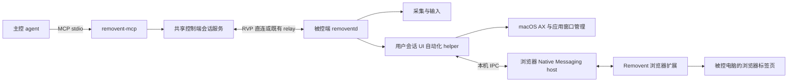

# Removent Computer Use 与浏览器桥接方案

状态：目标设计，已开始实现。评估基线：`2533c11`，日期：2026-11-10。

当前已实现的接口、配置与限制见 [Computer Use MCP 使用指南](../guides/computer-use-mcp.md)。下文能力矩阵是完整目标，不代表所有功能已交付。

2026-11-10 进展：MCP 已可借用桌面连接；host 已对同一 RVP viewer 的人工输入执行暂停、取消与输入释放，并通过控制 revision 拒绝旧请求。被控端新增只读本地输入监听、注入事件来源标记、监听失效后的变更阻断，以及本地/远端持有状态分离。恢复需要显式调用，旧观察随控制权切换失效。本地物理事件不会被拦截，取消是尽力停止剩余动作。5 项 RVP 原生验收和 1 项完整 MCP 原生验收已通过，覆盖 AX、键鼠派发、viewer 接管、OS tap 外部合成输入、安全输入切换及应用生命周期；物理 HID 接管和权限撤销仍未实测。桌面 UI 附加 MCP 自建连接和共享视频订阅仍待实现。

## 目标与结论

在主控电脑运行 agent 与 Removent MCP server，由 MCP 发起远程连接，并通过 Removent 协议操作被控电脑。目标是对齐本机 Computer Use 的观察、目标选择、元素操作、坐标操作与结果确认能力，同时支持浏览器标签页和 DOM 操作。

方案可行。现有 RVP 会话、画面解码、输入和认证可以复用；完整对齐还需要被控端的原生 UI 自动化服务、浏览器适配器，以及 RVP 自动化扩展。仅包装截图和鼠标事件属于中间里程碑，不能作为完整交付。

浏览器采用 Removent 自有扩展和 Native Messaging host。功能按被控端实际连接、版本、权限和目标能力开放；扩展缺失或不可用时，保留连接诊断与独立的原生桌面能力。

“无缝”指同一套操作语义、身份与会话可以用于远端，且操作后可以继续观察和判断。网络延迟、操作系统权限、应用是否提供可访问性信息仍会影响能力。MCP 工具返回图片后，agent 宿主也必须实际将图片交给视觉模型。

MCP 接入提供新的远程工具入口；现有本机 Computer Use 工具不会自动改为控制远端。可以在工具层之上提供 `remote.getApp()`、`target.getAXState()`、`target.click()` 等兼容适配接口，复用相同操作习惯；各 agent 宿主通过工具或 provider adapter 显式选择远程 session。

## 本机能力对齐

对齐基线为本次会话可用的本机 Computer Use 接口文档，以及浏览器工具定义。这里只比较能力和语义，不依赖某个 agent 产品的私有服务。浏览器工具定义已核对，但本次本机浏览器访问 host 不可用，因此没有浏览器实机验证。

| 本机能力 | Removent 目标接口 | 当前基础与缺口 |
| --- | --- | --- |
| `getState`、应用/窗口/浏览器清单 | `computer_state` | 新增被控端 inventory，明确各项能力是否可用 |
| `getApp`、应用启动和目标绑定 | `app_open`、`target_select` | 新增按 bundle ID、应用路径和窗口句柄绑定；句柄含进程生命周期 |
| `getAXState`，完整树与差量 | `ui_snapshot` | 新增 macOS AX 遍历、树版本和元素引用 |
| `getScreenshot` | `screenshot` | 已有解码 BGRA；补图片编码、裁切、尺寸与来源信息 |
| `getAXStateAndScreenshot` | `observe` | 同一目标返回树和图；标明各自采集时刻，不假装原子快照 |
| 元素点击或坐标点击，左右中键、多击、修饰键、按住时间 | `click` | 坐标事件可复用，元素操作和完整动作结果需新增 |
| 拖拽、悬停、滚动 | `drag`、`move`、`scroll` | 复用输入，补路径、节奏、滚动单位及终止语义 |
| 按键、快捷键、按住时间 | `press_key` | 封装现有 KeyEvent 和 FlagsChanged；使用符号键名 |
| 文本输入、粘贴、设置字段值 | `type_text`、`paste`、`set_value` | Unicode/纯文本剪贴板已有基础；AX 写值与远端剪贴板恢复需补齐 |
| 文本选择与光标定位 | `select_text` | 新增 AX selected text range，支持上下文消歧 |
| 展开、折叠等控件动作 | `ui_action` | 仅接受当前快照列出的动作，新增远端 AX 调用 |
| 浏览器选择、标签页清单/创建/绑定/关闭、前进后退刷新 | `browser_*` | 新增浏览器适配器 |
| 浏览器 DOM/AX 快照，元素点击、填充、选择、悬停、拖动 | `browser_snapshot`、`browser_action` | 新增可失效的元素引用与可操作性检查 |
| 浏览器截图、条件等待、对话框 | `browser_screenshot`、`browser_wait`、`browser_dialog` | 新增浏览器执行器；系统弹窗转原生 UI 目标 |
| 上传下载、页面脚本、日志 | 独立的可选工具与能力 | 文件传输尚无完整端到端实现；脚本和诊断单独声明范围 |

`type_text` 表示在当前焦点/目标中输入；`set_value` 表示替换可写字段值；`paste` 表示经剪贴板粘贴。三者不能用同一个实现隐式替代。macOS 本机粘贴的剪贴板恢复语义应在被控端实现：记录原内容与版本，仅在剪贴板仍由本次动作持有时恢复，避免覆盖用户期间的新复制。富文本需单独声明支持情况。

## 架构

主控侧 MCP 使用 stdio 起步，建议新增 `apps/mcp`，二进制名 `removent-mcp`。MCP 标准支持 stdio 与 Streamable HTTP；stdio 日志写 stderr，stdout 只输出协议消息。后续有远程 MCP 宿主需求时再增加独立认证的 HTTP 入口。[MCP transports](https://modelcontextprotocol.io/specification/2025-11-25/basic/transports)

两台电脑之间继续使用 RVP；浏览器调试端口和 UI helper 不直接暴露到网络。被控端用户会话 helper 负责访问当前登录用户的应用和浏览器，登录窗口服务只报告自身能力，不能因此取得其他用户浏览器会话。

原生 UI 适配器拟用 macOS `AXUIElement` 读取属性、列出动作和执行动作。某个应用不支持的属性或动作返回 `unsupported`，图像坐标路径仍可用。AX 调用需要期限和隔离工作线程；API 的超时可能意味着结果不明确，不能直接重试点击。[Apple AX actions](https://developer.apple.com/documentation/applicationservices/1462091-axuielementperformaction?language=objc)

控制端媒体依赖当前使用 VideoToolbox、apple-cf 和 Metal，首期应明确为 macOS 控制端与 macOS 被控端。Windows/Linux 控制端还需要可移植的解码后端，不能由 MCP 的跨平台性推导已有支持。

## 发起连接与生命周期

建议提供以下基础工具，以下名称均为拟议接口：

| 工具 | 用途 |
| --- | --- |
| `hosts_list` | 列出保存的主机、限时 LAN 发现结果及连接能力，不返回凭据 |
| `connect` | 接受保存的 host ID，或明确的直连/relay 目标；返回会话句柄与连接状态 |
| `session_status` | 查询阶段、目标身份、能力、等待用户操作的原因和最近错误 |
| `sessions_list` | 列出当前 MCP 调用方拥有的会话 |
| `disconnect` | 幂等关闭会话或取消连接，停止后续动作并释放输入 |

连接状态包括 `resolving → connecting → verifying_identity → authenticating → awaiting_admission → preparing → ready`，以及 `reconnecting / failed / closed`。可跳过不需要的阶段。`connect` 在短暂等待后返回进行中状态，不把现有最长 360 秒的准入等待直接挂在一次工具调用上。

已信任主机和已有授权凭据可直接连接；第一次连接通过本机确认或受支持的用户交互流程完成身份确认。原生凭据继续按“控制端身份、被控端指纹、认证方式”隔离，relay 凭据与被控端认证分开处理。MCP 使用凭据引用或本机安全输入，不把密码、OTP、完整邀请秘密写入工具结果、书签、日志或启动参数。MCP form elicitation 不用于索取密码等秘密，URL elicitation 仅在宿主声明支持时使用。[MCP elicitation](https://modelcontextprotocol.io/specification/2025-11-25/client/elicitation)

邀请连接沿用当前 LAN locator / relay alias 路径，成功后保存真实主机身份，不持久保存一次性秘密。会话恢复沿用现有规则，恢复后生成新的 `session_epoch` 并重新观察；不自动重放断线前未确认的点击或文本输入。

`ready` 必须包含可用能力和相应观察结果；视频路径至少拿到首帧后才能接受坐标动作。没有运行中的被控服务、网络不可达或系统权限未授权时，连接工具返回具体原因。启动本机 MCP 不等于可以安装/启动一台尚未配置的远程电脑。

## 观察与动作契约

每个目标包含 `session_id`、`session_epoch`、`target_id`。原生目标绑定应用/窗口及其生命周期；浏览器目标额外绑定 browser instance、profile、tab、frame。切换目标显式返回新状态，禁止依赖全局“最近一台电脑”。

每份观察返回 `observation_id`、树版本、图像尺寸、坐标空间、采集/接收时间及可用能力。元素引用至少绑定目标、epoch 与树/文档版本；导航、窗口销毁、重连或无法确认元素仍有效时返回 `stale_reference`，不得改点同编号的新元素。

图像使用 MCP `ImageContent`，状态使用 `structuredContent` 并提供兼容文本。不要只返回本地主机文件路径，也不要将原始视频帧持续塞入模型上下文。RVP 持续接收画面，MCP 按需返回最新观察。[MCP tools](https://modelcontextprotocol.io/specification/2025-11-25/server/tools)

坐标以本次返回图片的像素为准，裁切与缩放映射必须保存在 observation 中。桌面图像像素、RVP 采集像素、macOS 全局 points、浏览器 CSS pixels 是不同坐标空间。坐标动作携带 `observation_id`，由 bridge 转换；`FrameGeometry` 与鼠标动作进入同一 FIFO。显示器切换或几何变化使旧坐标观察失效，要求重新观察。

每个会话的变更动作串行执行。`click`、快捷键和拖拽由被控端或受控输入队列完成按下/释放序列，带修饰键时维护完整状态。滚动指定明确单位和目标；双击间隔、拖拽路径和长按时间不能由多次模型调用的网络延迟决定。取消时完成必要的释放，发送受阻则关闭连接触发 host 清理。

动作返回 `operation_id` 与分层结果：`queued`、`dispatched`、`observed` 或 `outcome_unknown`。`dispatched` 只证明输入/AX/浏览器执行器已完成对应派发，`observed` 证明取得了后续观察；业务成功仍按用户要求检查 UI 状态。动作序列中途失败时返回已执行前缀，不宣称回滚或原子性。

所有变更动作使用调用方提供的唯一 operation ID；同一 epoch 内重复请求返回已记录结果，相同 ID 携带不同参数直接拒绝。操作状态未知时先查结果或观察，禁止自动重试非幂等动作。有限去重记录过期后明确报告未知，不能承诺无限期 exactly-once。

提供有期限的状态/元素/URL 等待和动作后观察。可借鉴 Playwright 的可见、稳定、可交互和唯一定位检查；不能把固定 sleep 或 `networkidle` 当成所有页面完成的证明。[Playwright actionability](https://playwright.dev/docs/actionability)

## RVP 扩展与执行确认

现有控制消息没有通用动作回执。`InputSender::send` 成功只表示本地入队，host 的部分输入注入错误仅写日志。视频与控制使用不同流，动作后刚收到的一帧可能早已在网络中；当前 `KeyframeRequest` 还允许重编码缓存画面。因此“发出点击，然后等一帧”没有严格的因果保证。

建议增加协商后的自动化 bidi stream。命名和 feature bit 在实现时分配，不修改既有 `Caps` 的序列化字段布局。双方声明扩展后，在完成原有认证与准入的 RVP 连接内执行额外 automation capability grant；未获授权时不可打开执行通道。

扩展消息至少涵盖能力协商、目标清单、观察、动作、取消和结果。请求携带 schema version、request/operation ID、epoch、target、超时预算；响应携带执行阶段、错误和观察引用。使用有界长度帧，限制消息大小、并发和队列，图像/大树结果分块或独立流传输，避免阻塞输入。现有 pairing/clipboard 的 bidi 接收需要改为统一分流，避免多个任务竞争 `accept_bi`。

`InputBarrier`/动作结果必须位于真实执行序列之后。关联截图还需 host 在屏障后获得新的采集样本，绑定 action ID 与视频 frame ID/PTS，再由客户端解码匹配。禁止将屏障前的缓存关键帧标为动作后新采集。即使如此也只证明观察时间关系，异步应用渲染仍需条件等待。

新主控连接旧 host 时可声明 `pixel_only` 降级模式，但要公开显示缺少元素树、动作确认等能力；需要这些能力的工具直接返回 `unsupported_capability`。完整本机能力对齐要求升级被控端。

## 浏览器桥接

优先支持被控电脑已有 Chrome/Edge 会话，由 Removent 自有扩展、Native Messaging host 和受限 CDP 执行器提供能力。Removent 维护扩展与 native host 的接口版本、安装注册、能力协商和升级兼容，接入路径不依赖其他产品的浏览器 runtime。

### Removent 自有浏览器 provider

Chrome 的 debugger 扩展 API 可以附加标签页并调用包括 Accessibility、DOM、Input、Page 等域；它不是全部 CDP 域的无条件代理。[Chrome debugger](https://developer.chrome.com/docs/extensions/reference/api/debugger)

Native Messaging 负责扩展与本机 helper 通信，浏览器启动专用 host 进程，通过带长度的 JSON 消息交换数据，并用 extension ID 限定来源。专用 host 再连接 Removent 的用户级 IPC，不能假定浏览器直接接入已有 daemon 的 stdin。连接断开、扩展重启和浏览器 profile 生命周期必须使旧句柄失效；消息大小按该 API 限制实施分块。[Chrome native messaging](https://developer.chrome.com/docs/extensions/develop/concepts/native-messaging)

### 扩展可用性与功能开放

由被控端维护 browser provider registry，经已认证的 RVP 会话向主控报告。每条记录绑定用户会话、browser instance、profile instance、extension instance 和连接 generation；一个 profile 的扩展在线不能证明同一浏览器的其他 profile 可用。profile instance 使用独立标识，显示名称仅供辨认，不返回本机配置路径。

可用性分为安装信息、服务连接、协议兼容、授权范围和目标能力五层。安装信息用于引导；真实握手与执行时校验决定功能是否可用。没有握手时，不能仅凭超时判断扩展未安装。

| 状态 | 判断依据 | 对外能力 |
| --- | --- | --- |
| `unknown` | 尚未探测或安装信息不确定 | 状态查询与配置说明 |
| `not_installed` | 安装管理能够确认当前目标 profile 未安装 | 安装引导 |
| `disconnected` | 无有效 native port；可能为浏览器关闭、扩展禁用或 host 故障 | 诊断和重连状态，不提供浏览器动作 |
| `incompatible` | 扩展与 host 无共同协议版本 | 返回需要升级的组件，不派发动作 |
| `permission_required` | 缺少所需浏览器权限或 Removent 会话授权 | 已获授权的能力仍可用，其余返回具体缺项 |
| `ready` | 有效握手、连接存活、协议兼容 | 仅开放协商并获授权的能力 |

建议的握手包含协议版本范围、扩展/host 版本、实例标识、连接 generation 和 supported capabilities，响应选择共同版本并分配会话句柄。来源校验由 native host 的 extension allowlist 和用户级 IPC 对等进程校验执行，不信任消息中自行填写的身份。每条请求还必须绑定当前 Removent session 的授权范围。

有效能力取“扩展实现、host 实现、当前浏览器权限、远程会话授权、目标支持情况”的交集。按 `tabs.list`、`tabs.create`、`dom.snapshot`、`dom.interact`、`screenshot`、`downloads`、`uploads`、`evaluate` 等分别声明，不用单一 `browser=true` 代表全部可用。未实现的文件传输不会因扩展支持上传而被自动开放。

`browser_status`/能力发现入口常驻，返回状态、`available_actions`、不可用原因、修复建议和单调递增的 `capability_revision`。MCP 与桌面 UI 根据当前目标的能力目录提供操作入口；工具传输层即使保留固定名称，也不能把它当成目标已支持的证据。所有执行请求在 host 与扩展侧再次校验，过期能力缓存返回 `capability_changed` 或 `browser_unavailable`。多会话时，某台电脑的扩展离线只撤销该电脑相应 browser instance 的能力。

RVP 连接建立时获取完整能力快照，此后用有版本的事件更新。事件遗漏、revision 不连续或重连后重新拉取全量；native port 关闭、浏览器退出、扩展禁用/升级或权限撤销应及时更新状态。心跳租约用于发现未正常关闭的连接，超过期限撤销可用能力；不因缓存显示 ready 而无限等待。

浏览器级 ready 不保证某个标签页可操作。受限页面、debugger attach 失败、其他调试器占用、页面导航或目标关闭等由目标级检查返回具体错误。连接丢失时停止未执行任务；已经派发且未收到结果的动作标记 `outcome_unknown`，重连后不自动重放。恢复握手后递增 generation，使旧 tab/element 引用失效。

扩展不可用时，原有桌面截图、鼠标键盘和可用 AX 功能保持独立。调用浏览器 DOM 工具失败时明确报告，不自动改用坐标点击执行同一动作。安装/启用扩展后可以刷新能力，无需重新创建整个远程桌面会话。

### 浏览器操作范围

浏览器工具至少提供：

- 清单和生命周期：浏览器、profile、tabs，创建/绑定/激活/关闭标签页，导航/后退/前进/刷新。
- 观察：URL、标题、frame、DOM/AX 快照、可交互元素引用、viewport/整页截图。
- 操作：click、double click、hover、fill、type、press、select、drag、scroll、条件等待、网页对话框。
- 可选能力：受限定的页面 evaluate、控制台/网络诊断、上传下载。执行能力不能由页面内容自动扩大。

跨域 iframe、Shadow DOM、SPA 更新、弹窗和页面遮挡必须进入验收。浏览器元素引用不能冒充原生 AX 引用。页面脚本超时、导航中断、debugger 被分离都返回具体状态。浏览器地址栏、下载面板和系统文件对话框用原生 UI 路径处理。

如果需要隔离的自动化浏览器，可增加由远端 helper 启动的 Playwright browser provider。`connectOverCDP` 仅支持 Chromium，且官方明确其保真度低于 Playwright 自有连接，不能宣称连上任意 CDP 就拥有全部 Playwright 能力。Safari/Firefox 使用独立 provider，未实现前仅提供已支持的原生图像/AX 路径。[Playwright BrowserType](https://playwright.dev/docs/api/class-browsertype)

上传文件必须区分主控文件与被控文件，使用明确的 artifact ID 与传输步骤；主控路径不能直接当远端路径。当前 RVP 文件传输尚未端到端实现，因此跨电脑文件操作是独立依赖项。

## 会话共享与授权范围

当前 host 对第二条 RVP 会话返回 Busy。独立 MCP 可以先占用一条正常会话，但这无法同时满足“人看着桌面窗口、agent 操作同一会话”。完整方案应让桌面 UI 和 MCP 使用同一个控制端 session broker，视频和观察可多订阅，输入只有一个控制租约。人接管时停止 agent 动作并释放所持输入，不自动新建第二条远程连接。

RVP automation grant 细分为原生观察/操作、浏览器观察/操作、剪贴板、文件、页面执行等范围。旧的 input/clipboard 授权不自动扩展成读取所有应用树或所有浏览器 profile。MCP 负责工具入口，host 执行已授范围、会话所有权与撤销；被控端提供连接状态和停止入口。

## 源码落点

| 位置 | 可复用基础或计划变更 |
| --- | --- |
| `packages/client/src/session/mod.rs` | ClientSession、decoded_bgra_rx、输入方法；补观察与动作结果 API |
| `packages/client/src/session/handshake.rs` | 保留 Negotiate 中 displays/selected_display；当前只把 NegotiateAck 留给会话 |
| `packages/client/src/session/media.rs` | BGRA 输出，native_video=false 可供图片编码；补 frame ID 与动作关联 |
| `packages/client/src/input_queue.rs` | 输入、FrameGeometry 顺序及背压 |
| `apps/desktop/src/engine/{native,compatibility,credentials}.rs` | 将直连/relay/邀请、认证回调和凭据复用抽成共享控制端服务，解除 UiEvent 依赖 |
| `packages/client/src/{host_pins,keychain,saved,recovery}` | 复用身份、书签、凭据存储与重连规则 |
| `packages/host/src/session/control.rs` | 增加执行结果；保留现有输入清理和限流 |
| `packages/host/src/session/handshake.rs` | 当前只协商所选的一块显示器；多屏切换需要实现端到端流程 |
| `packages/host/src/runner` | 单会话限制、用户会话/登录窗口生命周期、helper 接入 |
| `packages/proto`、`packages/net` | 追加自动化能力、stream 分流与消息 schema，不改变旧消息含义 |
| 新增 `packages/automation`、`apps/browser-extension` | 原生 UI provider、浏览器 provider、共享动作与观察类型 |
| 新增 `apps/mcp` | MCP 工具 schema、图片响应、会话管理与错误映射 |

`SelectDisplay`、`DisplayListUpdate`、光标等枚举定义不能当作已实现能力；本次查阅的 host/client 控制泵没有完整对应处理。多屏、原生应用树、浏览器桥接均要按端到端行为验收。

## 实施与验收

1. **契约与共享会话基础**：固定上述能力矩阵、句柄与错误 schema，抽出非 UI 的连接流程，完成 connect/status/disconnect；使用保存主机与直连覆盖身份确认、认证失败、取消、Busy 和重连。
2. **像素控制阶段**：截图、坐标点击/多击/拖拽/滚动、快捷键、中文/Emoji/多行文本，覆盖 Retina、图像裁切、分辨率变化、静态画面、断线释放。明确这是降级能力。
3. **原生对齐阶段**：被控端 AX helper、应用/窗口管理、元素动作、选择文本、动作回执及后续观察，补多屏与共享 session broker。按对齐表逐项标记支持、受限或不可用。
4. **浏览器阶段**：实现 Removent 自有扩展、Native Messaging host、可用性检测和按目标开放的能力目录。Chrome/Edge 已有会话桥接覆盖标签页生命周期、DOM/AX、元素输入、选择、拖拽、iframe、Shadow DOM、导航失效和弹窗；补远端文件与可选 provider。
5. **真实跨机验收**：同一测试任务分别通过本机 provider 和远端 provider 执行，比较目标选择、最终 UI、错误和取消语义；覆盖直连、QUIC relay、WSS relay，并记录实际延迟。

测试分层：协议/句柄/去重/坐标单元测试，真实 client-host + fake provider 集成测试，受控原生测试应用及浏览器 fixture 的 OS 级验证，最后两台真实电脑上的 agent 闭环。测试必须包含 stale ref 不点错、未知结果不重放、MCP 退出释放输入、权限撤销、浏览器断开与用户接管。

扩展可用性验收包括未安装/未连接的区分、native host 缺失、扩展被禁用、协议版本不匹配、部分权限缺失、多浏览器/profile 隔离、握手后掉线、心跳过期、事件遗漏后的全量恢复、旧 revision 请求被拒绝、运行中安装/升级后的能力刷新，以及故障时原生桌面操作仍然可用。

性能分别记录连接至首个可用观察、动作派发、动作后观察、树/图字节数和 MCP 响应大小的 p50/p95；不将 RVP 帧率当作 agent 操作延迟。完整交付以能力矩阵和真实任务结果为准。
